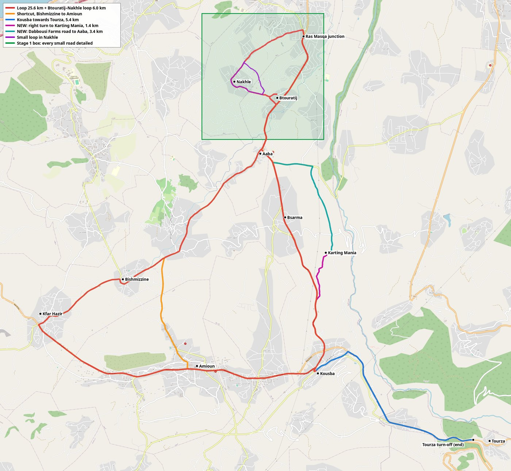
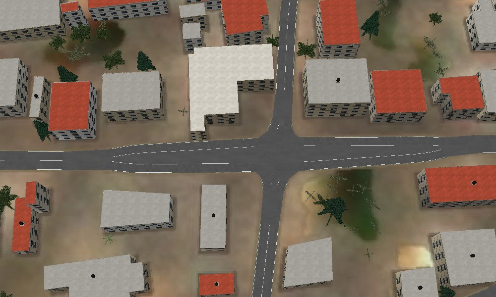
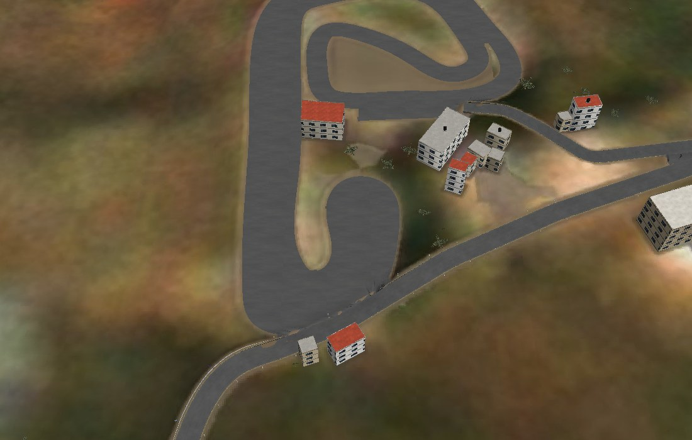

# Koura track

A free-roam map of Koura, North Lebanon, for **Assetto Corsa**: the villages of Btouratij, Nakhle, Aaba, Bishmizzine, Kfar Hazir, Amioun, Kousba and Bsarma, the roads between them, and the Karting Mania kart track. It is generated from open map data by a Python script, with no 3D modelling tool involved.

This is a personal project and a work in progress. See the [changelog](CHANGELOG.md) for every build so far and the [roadmap](ROADMAP.md) for what is done and what is next.



## What is in the map today

| | |
|---|---|
| Area built | 27.5 km², 12 km across |
| Roads | 198 km, every street in the mapped villages |
| Main loop | 25.6 km: Btouratij, Aaba, Bishmizzine, Kfar Hazir, Amioun, Kousba, Bsarma, back to Btouratij |
| Buildings | about 6,100 |
| Start points | 11, one per village plus the kart paddock |
| Kart track | 832 m racing line traced from aerial imagery |
| Track size | about 700 MB, 8 million vertices |

| A junction on the Amioun to Kousba road | Karting Mania |
|---|---|
|  |  |

Both are software renders of the built track without aerial imagery.

## How it is made

1. **Data.** Roads and buildings from OpenStreetMap, more building outlines from Microsoft, heights from the Copernicus 30 m model, tree positions from a canopy height model, ground colour from aerial imagery.
2. **Generator.** [OpenLaps](https://github.com/theopenlaps/openlaps) (MIT), pinned to one commit, with the changes in [`koura/openlaps_koura.patch`](koura/openlaps_koura.patch). The patch adds, among other things:
   - a free-roam zone that follows the roads instead of a square;
   - a Lebanon building and vegetation profile (flat roofs with water tanks, olive groves);
   - road grades smoothed over the whole network at once, so a road keeps its line through every junction;
   - a purpose-built surface for the kart track.
3. **Driver.** [`koura/build.py`](koura/build.py) reads [`handoff/inputs/zone.json`](handoff/inputs/zone.json) (origin, stages, routes, start points) and writes an Assetto Corsa track folder.
4. **Checks.** [`koura/ride.py`](koura/ride.py), [`koura/grade.py`](koura/grade.py) and [`koura/survey.py`](koura/survey.py) walk the built road surface and report bumps, dips and holes, so smoothness is measured rather than guessed.

## Build it yourself

Linux, about 22 GB of free memory for the full map, Python 3.12.

```bash
git clone https://github.com/AdamElHassanDev/koura-track && cd koura-track
koura/setup.sh                                   # generator + Python environment

# the kart track alone, 1 minute
(ulimit -v 8000000;  .venv/bin/python koura/build.py K  --name kart_test)

# Btouratij and Nakhle, 3 minutes
(ulimit -v 21000000; .venv/bin/python koura/build.py S1 --name koura_s1)

# the whole map, 20 minutes
(ulimit -v 22000000; .venv/bin/python koura/build.py S2 --name koura --title "Koura")
```

The track folder appears in `out/<stage>/assetto_corsa/<name>`. Copy it to `assettocorsa/content/tracks/`. Custom Shaders Patch is required.

Add `--no-imagery` to build without downloading aerial imagery (plain ground textures instead).

The built track is not stored in this repository: it is large, changes with every build, and contains aerial imagery that cannot be redistributed. Everything needed to rebuild it is here.

## Repository layout

| Path | What |
|---|---|
| [`koura/`](koura/) | build driver, kart track trace, measuring tools, generator patch, map-data snapshot |
| [`handoff/`](handoff/) | the project plan: work packages, quality bar, findings, progress ledger |
| [`handoff/inputs/`](handoff/inputs/) | the zone, routes, start points and list of recent places |
| [`handoff/evidence/`](handoff/evidence/) | measurements and maps that back the claims in the ledger |
| [`docs/`](docs/) | images for this page |
| [`CHANGELOG.md`](CHANGELOG.md) | every build installed in the game, with the owner's feedback |
| [`ROADMAP.md`](ROADMAP.md) | status of each work package |

Start with [`handoff/START_HERE.md`](handoff/START_HERE.md) for the plan and [`handoff/PROGRESS.md`](handoff/PROGRESS.md) for the detailed state.

## Tracking progress

- **`CHANGELOG.md`** gets an entry for every build that is installed in the game, with what changed, the measured smoothness and what the owner said after driving it.
- **`ROADMAP.md`** shows each work package as done, partly done or not started.
- **`handoff/PROGRESS.md`** is the working ledger: one row per piece of work, with the evidence and whether it was driven or only checked from files.
- **`handoff/evidence/survey.json`** lists every road by its worst slope jump, with coordinates, from the latest build.

## Status

Build 8. The road network has measured smooth grades, start points in every village, the Lebanon look, and the first real kart track surface. Next: junction shapes, missing buildings, tyre walls and timing at the kart track, fine detail in Btouratij and Nakhle. Details in the [roadmap](ROADMAP.md).

## Credits and licences

- Map data © [OpenStreetMap](https://www.openstreetmap.org/copyright) contributors, ODbL. The snapshot in `koura/data/` is OpenStreetMap data.
- Generator: OpenLaps, MIT.
- Heights: Copernicus DEM GLO-30. Building outlines: Microsoft Global ML Building Footprints. Canopy height: Meta and WRI.
- Aerial imagery is used only at build time and is not included here.
- This project's own code and documents: MIT, see [`LICENSE`](LICENSE).
